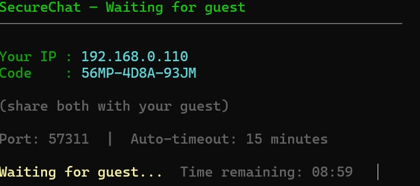
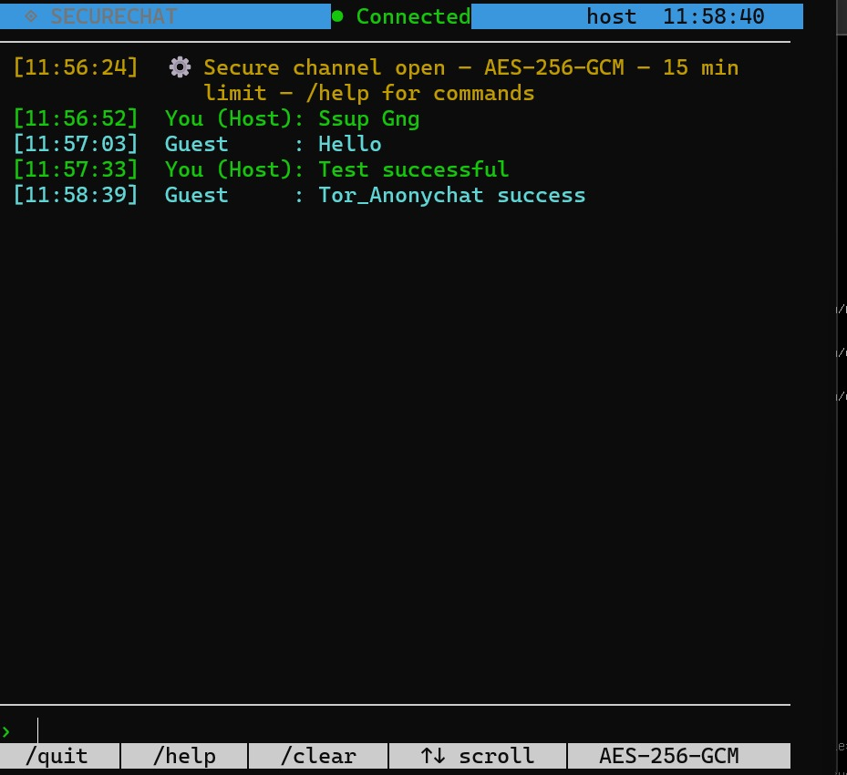

# TOR_ANONYCHAT

## What is it?

SecureChat is a zero-knowledge ephemeral group chat application that runs entirely in your terminal. Up to **10 people** connect directly through a Tor hidden service (or a local network) using a one-time session code. The host controls who enters — every new joiner waits in a lobby and is only admitted when the host types `/admit <nickname>`.

When the session ends every trace is wiped from memory. Nothing is ever written to disk.

---

## Security model

| Property | Details |
|---|---|
| **Encryption** | AES-256-GCM — authenticated, no separate MAC needed |
| **Key derivation** | PBKDF2-HMAC-SHA256, 310 000 iterations (OWASP 2023 minimum) |
| **Nonce** | 12 bytes, random per message — NIST SP 800-38D |
| **Transport** | Tor hidden service — no IP address ever leaves any machine |
| **Session code** | One-time use, ~60-bit entropy (12 chars from a 32-symbol Base32 alphabet) |
| **Logs** | None. No history. No files written to disk by the app |
| **Keepalive** | PING/PONG every 30 s — dead connections detected within ~90 s |
| **Max users** | 1 host + up to 9 guests (10 total) |

---

## Requirements

| Requirement | Details |
|---|---|
| **OS** | Linux (Kali, Ubuntu, Debian), macOS, Git Bash / WSL on Windows |
| **Python** | 3.8 or newer (`python3 --version`) |
| **Library** | `cryptography` — auto-installed by `run.sh` |
| **Network** | All machines must reach the host over TCP (same LAN, VPN, Tor, or port-forwarded) |

---

## Installation

```bash
# 1. Clone or download and unzip
git clone https://github.com/Br1an-devs/Tor_Anonychat
cd Tor_Anonychat

# 2. Make the launcher executable
chmod +x run_tor.sh run.sh

# 3. (Optional) install the Python dependency manually
pip install cryptography
```

No build step. No compilation.

**For full setup instructions → [`Test-sample/instructions.txt`](./Test-sample/instructions.txt)**

---

## One-time Tor setup (HOST only)

Run these commands once to create your hidden service and get your permanent onion address:

```bash
# 1. Add the hidden service block to the Tor config
sudo bash -c 'printf "\n# SecureChat\nHiddenServiceDir /var/lib/tor/securechat\nHiddenServicePort 57311 127.0.0.1:57311\n" >> /etc/tor/instances/default/torrc'

# If the above path does not exist on your system:
sudo bash -c 'printf "\n# SecureChat\nHiddenServiceDir /var/lib/tor/securechat\nHiddenServicePort 57311 127.0.0.1:57311\n" >> /etc/tor/torrc'

# 2. Create the hidden service directory
sudo mkdir -p /var/lib/tor/securechat
sudo chown debian-tor:debian-tor /var/lib/tor/securechat
sudo chmod 700 /var/lib/tor/securechat

# 3. Restart Tor
sudo systemctl restart tor@default

# 4. Wait ~15 s, then read your onion address
sleep 15 && sudo cat /var/lib/tor/securechat/hostname
```

Your onion address looks like:
`abcdef1234567890abcdef1234567890abcdef1234567890abcdef12.onion`

**Save this address — it is permanent as long as you keep the key files.**

Get it any time:
```bash
sudo cat /var/lib/tor/securechat/hostname
```

---

## How to run

### Over Tor (recommended)
```bash
bash run_tor.sh
```

### Over LAN without Tor
```bash
# Host
bash run.sh host --port 57311

# Guest
bash run.sh connect --port 57311
```

### Directly with Python
```bash
# Host with a custom nickname
python3 -m securechat host --port 57311 --nick Alice

# Guest with a custom nickname
python3 -m securechat connect --port 57311 --nick Bob

# Interactive menu
python3 -m securechat
```

---

## Session flow

### HOST

1. Run `bash run_tor.sh` and choose **Host a room**.
2. Enter your nickname (or leave blank for "Host").
3. A session code is generated and shown alongside your onion address (or LAN IP).
4. **Share both** the address and the session code with all guests via a secure out-of-band channel (Signal, phone call, etc.).
5. The chat panel opens immediately — you can start typing while guests connect.
6. When a guest joins, a yellow **🔔 Waiting** bar appears at the top of the screen showing their nickname.
7. Type `/admit <nickname>` to let them in, or `/deny <nickname>` to reject them.
8. Repeat for each guest. The room stays open until you quit.

### GUEST

1. Run `bash run_tor.sh` and choose **Join a room**.
2. Enter the host address (IP or `.onion`), the session code, and your nickname.
3. You will see:
   ```
   Sending join request as 'Bob'...
   Waiting for host to accept your request...
   ```
4. Wait. The host must type `/admit Bob` in their chat panel.
   - If admitted → you enter the live group chat.
   - If denied → you see the reason and the app exits cleanly.
5. Once inside, all messages are broadcast to every participant in real time.

---

## Room lifetime

The room and its connection stay alive **as long as the host process is running** — individual guests joining or leaving do not affect the room or the other participants.

| Event | What happens |
|---|---|
| Guest disconnects (Ctrl+C, network drop) | Only that guest is removed. Everyone else stays. |
| New guest connects | They enter the lobby until `/admit`-ed. Room keeps running. |
| Host types `/kick <nick>` | That guest is removed with a BYE message. Room keeps running. |
| Host quits (Ctrl+C or `/quit`) | BYE is sent to all guests. Room closes. |
| Guest quits (Ctrl+C or `/quit`) | BYE is sent to host. Only that guest leaves. |
| TCP/network error for one guest | Guest reaped after 3 missed keepalives (~90 s). Others unaffected. |

---

## In-chat commands

### All users
| Command | Action |
|---|---|
| `/help` | Show available commands |
| `/quit` or `/exit` | Leave the session (sends BYE) |
| `/clear` | Clear the visible message history |
| `↑` / `↓` | Scroll through message history |
| `Ctrl-W` | Clear the input line |

### Host only
| Command | Action |
|---|---|
| `/admit <nick>` | Admit a waiting guest into the room |
| `/deny <nick>` | Reject a waiting guest (optional reason: `/deny <nick> Too late`) |
| `/kick <nick>` | Remove an admitted guest from the room |
| `/who` | List current participants and the waiting lobby |

### File transfer (2-user / guest→host)
| Command | Action |
|---|---|
| `/sendfile <path>` | Offer a file (AES-256-GCM encrypted, SHA-256 verified) |
| `/accept` | Accept an incoming file offer |
| `/reject` | Reject an incoming file offer |
| Received files | Saved to `~/securechat_received/` |

---

## What the UI looks like

**Host panel** — the yellow bar shows guests waiting for approval:

```
◈ SECURECHAT [GROUP]       ● 2 guests connected        host  14:22:01
──────────────────────────────────────────────────────────────────────
🔔 Waiting: Charlie  |  Diana
──────────────────────────────────────────────────────────────────────
[14:21:44]  ⚙  ⟶  Bob joined the room
[14:21:59]  Alice (host)   : hey everyone
[14:22:00]  Bob            : hello!
──────────────────────────────────────────────────────────────────────
›  /admit Charlie
──────────────────────────────────────────────────────────────────────
 /quit │ /help │ /admit <nick>  /deny <nick>  /kick <nick>  /who │ AES-256-GCM
```

**Guest panel** (while waiting):
```
Sending join request as 'Bob'...
Waiting for host to accept your request...
```

**Guest panel** (admitted):
```
◈ SECURECHAT [GROUP]       ● Connected                  guest  14:22:00
```

*Screenshot of an actual host session:*
<p align="center">
  
</p>

*After connection:*
<p align="center">
  
</p>

---

## Security notes

- Never share the session code or onion address over unencrypted channels.
- The session code is one-time use — generate a new one for every session.
- No logs, no history, no IP addresses leave any machine (over Tor).
- All messages and files are encrypted end-to-end with AES-256-GCM.
- The host never sees guest IP addresses — Tor hides both ends.

---

**FOR SUPPORT 🤝**

[](https://ko-fi.com/briandevs)
